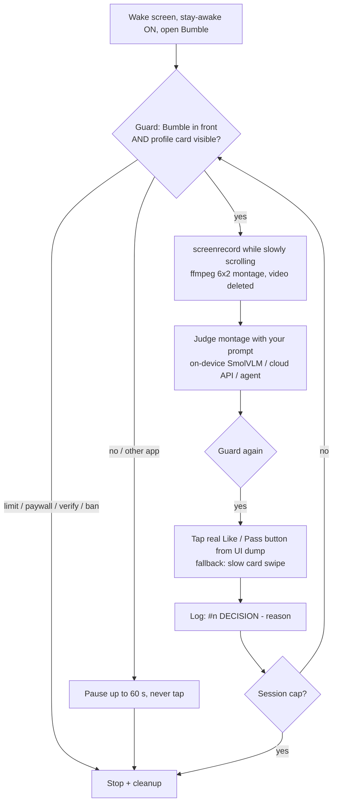

# 🐝 Bumble Auto-Swiper for Android

> ## ⚠️ Disclaimer
> **This project is for educational purposes only.** Bumble's Terms of Service prohibit automation and bots. Using this, **especially frequently, might get your Bumble account banned**. You are solely responsible for how you use it. **Use at your own risk.** It is not affiliated with or endorsed by Bumble.

A **guarded**, privacy-friendly auto-swiper that runs **entirely on a non-rooted Android phone in Termux**: no laptop, no root, no PC needed. Termux talks to the phone's own ADB over Wireless debugging, records each profile while scrolling, builds a photo montage, judges it with an **on-device vision model** (SmolVLM-256M via llama.cpp) against **your own preference prompt**, and taps Like or Pass, but only after verifying Bumble and a real profile card are on screen.

A laptop / server / AI agent can optionally drive the same scripts remotely over Tailscale.

Also ships a [`SKILL.md`](SKILL.md) so an AI agent can set it up and run it step by step.

## How it works



| Piece | Phone-only (default) | Remote (optional) |
|---|---|---|
| Runs on | Termux on the phone | Laptop / server / agent box |
| ADB target | `127.0.0.1:5555` (its own adbd) | `<PHONE_TAILSCALE_IP>:5555` |
| Judge | `local`: SmolVLM-256M, ~50 s / profile, offline · or `api` | `agent` (agent looks at montage), `api`, or `local` over SSH |

The scripts detect Termux vs laptop automatically.

## Requirements
- A **non-rooted Android 11+** phone (tested on a Samsung Galaxy S21 FE, Android 14), on Wi-Fi (Wireless debugging needs Wi-Fi). A spare phone is best.
- **Termux** and **Termux:Boot** from [F-Droid](https://f-droid.org/packages/com.termux/) (the Play Store Termux is outdated). Optional: **Termux:API** (finish notification).
- ~400 MB free storage (llama.cpp + 280 MB model). 64-bit ARM (aarch64) for `llama-cpp`.
- Bumble installed, logged in, filters set by hand.
- Optional remote mode: **Tailscale** on the phone and the controller, and `adb`, `ffmpeg`, `python3` on the controller.

## Quick start (phone-only, Termux)

### 1. Phone settings
1. Settings → About phone → Software information → tap **Build number** 7 times.
2. Settings → Developer options → **Wireless debugging** → ON.
3. Optional but handy: Developer options → Quick settings developer tiles → **Wireless debugging** (one-tap re-enable after reboots).
4. Settings → Apps → **Termux** and **Termux:Boot** → Battery → **Unrestricted** (otherwise Android kills the run in the background).
5. Open **Termux:Boot** once so it registers.

### 2. Install (one command)
In Termux:
```bash
pkg install -y git
git clone https://github.com/romit07/bumble-auto-swiper ~/bumble-auto-swiper && cd ~/bumble-auto-swiper
bash install.sh
```
`install.sh` installs `android-tools ffmpeg python termux-api llama-cpp curl`, downloads the model (asks first), installs the boot script to `~/.termux/boot/`, creates `config.env`, takes a wake lock, and adds three commands: `bumble-swipe`, `bumble-step`, `bumble-stop`.

Model download by hand, if you prefer:
```bash
mkdir -p ~/models && cd ~/models
curl -LO https://huggingface.co/ggml-org/SmolVLM-256M-Instruct-GGUF/resolve/main/SmolVLM-256M-Instruct-Q8_0.gguf
curl -LO https://huggingface.co/ggml-org/SmolVLM-256M-Instruct-GGUF/resolve/main/mmproj-SmolVLM-256M-Instruct-Q8_0.gguf
```

### 3. Pair Termux's adb with the same phone (one time)
1. Put **Settings → Developer options → Wireless debugging** and **Termux** in **split screen** (or pop-up view).
2. In Settings tap **Pair device with pairing code**. Keep that dialog open.
3. In Termux run `bash termux/pair-adb.sh` and type the pairing port + 6-digit code, then the debug port from the main Wireless debugging screen. By hand it is:
   ```bash
   adb pair localhost:<PAIRING_PORT> <CODE>
   adb connect localhost:<DEBUG_PORT>
   adb -s localhost:<DEBUG_PORT> tcpip 5555
   adb connect 127.0.0.1:5555
   adb -s 127.0.0.1:5555 shell echo ok     # -> ok
   ```
Every script then runs commands as `adb -s 127.0.0.1:5555 shell ...`.

### 4. Set your preference
Edit [`prompt.example.txt`](prompt.example.txt) (or set `PROMPT_FILE` in `config.env`). Example rule:
- **LIKE-lean**: appears lean / low body fat
- **LIKE-default**: build can't be judged (face-only, heavy clothes, group shots, unclear photos)
- **SKIP**: clearly not lean
- **SKIP always**: appears under 18, or photos clearly fake / don't match the profile

The cloud/agent judges read this prompt directly. The tiny on-device model answers simple yes/no questions mapped to the same rule (see `termux/judge-profile.sh`) and leans toward LIKE-default when unsure.

Other settings in `config.env`: `MAX_PROFILES` (session cap, default **50**), `JUDGE` (`local`/`api`/`agent`), `SCROLLS`, `PAUSE_WAIT`, API URL/key/model for `api`.

### 5. Run
```bash
bumble-swipe 20        # 20 profiles (never more than MAX_PROFILES)
```
Then **leave the phone alone**. The script brings Bumble to the front and keeps working from the background (Termux holds a wake lock and shows its notification). The screen stays on only during the run (`svc power stayon true` → `false` at the end). When it finishes you get a notification (with Termux:API), and the summary is in `state/session.log`:
```bash
bumble-step status     # counts of LIKE-lean / LIKE-default / SKIP
tail state/session.log
bumble-stop            # manual cleanup if you interrupted it (Ctrl+C also cleans up)
```
**Sharing the screen:** Termux and Bumble can't both be in front. If you switch to Termux (or a call/notification takes over), the runner *pauses* without tapping and waits up to `PAUSE_WAIT` seconds (default 60) for Bumble to come back, then stops cleanly. To watch progress live, use split screen *before* starting, or check the log afterwards.

## After a reboot
Android always switches Wireless debugging **off** at boot, and a non-rooted app can't switch it back on (`settings put global adb_wifi_enabled 1` needs `INTERACT_ACROSS_USERS`). So:
1. Turn **Wireless debugging** on (Quick Settings tile).
2. `~/.termux/boot/start-adb.sh` (run by Termux:Boot) is already waiting: it finds the random debug port (mDNS, else a port scan), runs `adb tcpip 5555`, and `127.0.0.1:5555` works again within ~30–60 s. Log: `~/boot-adb.log`.

## Optional: remote controller (laptop / server / AI agent)
1. Install Tailscale on the phone (Play Store or F-Droid) and the controller, same account.
2. Controller: `sudo apt install adb ffmpeg python3` (or `brew install android-platform-tools ffmpeg`), clone the repo, `bash install.sh`.
3. In `config.env` set `PHONE_HOST=<PHONE_TAILSCALE_IP>` (or MagicDNS name). The phone still needs `adb tcpip 5555` (pairing step / boot script above).
4. `./scripts/adb-reconnect.sh` → `connected: ...`
5. Run `./scripts/run.sh 20` with `JUDGE=api`, or let an agent use **step mode** and judge each montage itself:
   ```bash
   ./scripts/swipe.sh start                         # prints montage path
   ./scripts/swipe.sh decide LIKE-default "face-only photos"
   ./scripts/swipe.sh stop
   ```
   For `JUDGE=local` from a laptop, also set `SSH_USER` / `SSH_KEY` (Termux `sshd` on port 8022) so the image is judged on the phone.

**Never expose port 5555 or 8022 to the internet**: ADB is full control of the phone. Tailscale only.

## Files
| Path | What |
|---|---|
| `install.sh` | One-command setup (detects Termux vs laptop) |
| `config.example.env` | All settings → copy to `config.env` (gitignored) |
| `prompt.example.txt` | Your preference rule for the judge |
| `scripts/run.sh` | Automatic guarded loop (`bumble-swipe`) |
| `scripts/swipe.sh` | Step mode: `start` / `decide` / `status` / `stop` (`bumble-step`) |
| `scripts/guard.sh` | Foreground + profile-card + blocker check (run before every action) |
| `scripts/capture.sh` | screenrecord while scrolling → ffmpeg montage |
| `scripts/judge.sh`, `judge-api.py` | Judge dispatcher, OpenAI-compatible vision API client |
| `scripts/act.sh` | Tap Like/Pass from UI-dump bounds, fallback slow swipe, confirm dialogs |
| `scripts/ui.sh` | Text dump of the current screen |
| `scripts/cleanup.sh` | Delete captures, HOME, stay-awake off (`bumble-stop`) |
| `scripts/adb-reconnect.sh` | Fix hanging/offline adb |
| `termux/judge-profile.sh` | On-device SmolVLM-256M judge (llama-mtmd-cli) |
| `termux/pair-adb.sh` | One-time self-pairing helper |
| `termux/start-adb.sh` | Termux:Boot script: reopen adb on 5555 after reboot |

## Safety built in
- **Guard before every action**: Bumble's main activity must be in front and a profile card visible. Otherwise pause/stop. No blind taps, ever.
- **Stops** on like limits, paywalls, premium upsells, verification, warning, ban or sign-in screens.
- **Never** uses SuperSwipe, Boost, Spotlight, compliments or anything paid; never messages; never edits your profile or filters.
- **Session cap** (`MAX_PROFILES`, default 50). Slow, human-like scroll swipes. Keep sessions small and infrequent: that lowers (but does not remove) ban risk.
- **Always skips** anyone who appears under 18.
- **Privacy**: profile videos are deleted right after the montage is made, and montages after each decision. The log stores only `#n DECISION — reason`, no names or images. Nothing leaves the phone in `local` mode.

## Lesson learned: why the first version broke
The first runner tapped and swiped **fixed screen coordinates** and never checked which app was actually in front. When Bumble lost focus and the phone dropped back to the launcher, those coordinates hit the home-screen **Camera** icon (and other apps). The runner kept "deciding" anyway, logging profiles it had never seen as "no photo" skips. The fix is the design above: check the foreground activity and a real profile card before **every** action, read button positions from the live UI dump instead of hard-coding them, and stop instead of guessing.

## Troubleshooting
| Symptom | Fix |
|---|---|
| `adb: device offline` / commands hang | `scripts/adb-reconnect.sh`. In Termux: `adb kill-server; adb connect 127.0.0.1:5555` |
| `failed to connect to 127.0.0.1:5555` after reboot | Turn Wireless debugging on; wait a minute; check `~/boot-adb.log`. Make sure Termux:Boot was opened once and is battery-unrestricted |
| Pairing fails | The code expires in ~60 s, and the pairing port differs from the debug port. Retry with split screen |
| "Allow wireless debugging on this network?" | Tap Allow (tick "Always allow") once per Wi-Fi network |
| `GUARD_FAIL wrong foreground` | Another app/dialog is in front. Close it (back out of system update prompts, never accept), reopen Bumble, run again |
| `GUARD_FAIL no profile card` | Bumble is on another tab, has no more profiles, or changed its UI. Run `scripts/ui.sh`; update `CARD_MARKER` / `LIKE_DESC` in `config.env` |
| Runner stops with `BLOCKER` | Like limit / paywall / verification. That's by design: stop for the day |
| Run dies when the screen turns off | Battery → Unrestricted for Termux; `termux-wake-lock`; keep the phone charging |
| `llama-mtmd-cli: not found` | `pkg upgrade && pkg install llama-cpp` (aarch64 only) or use `JUDGE=api` |
| Judge very slow (> 2 min) | Close other apps, set `LLAMA_THREADS` to your big-core count, or use `JUDGE=api` |
| Montage is black | Some apps block screen capture (FLAG_SECURE); Bumble didn't at time of writing. Check `scripts/capture.sh` output |
| `uiautomator dump` fails / stale screen | Scripts delete `/sdcard/ui.xml` before each dump; if it still fails, wait for animations to finish and retry |
| Taps land in wrong place on another phone | Buttons come from the UI dump, so this only affects the fallback swipe; set `SCREEN_W`/`SCREEN_H` in `config.env` if `wm size` reports oddly |

## License
[MIT](LICENSE) © 2026 Romit Kumar
